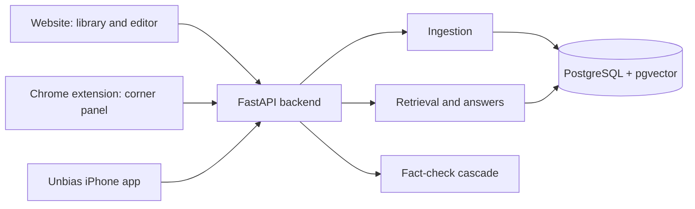
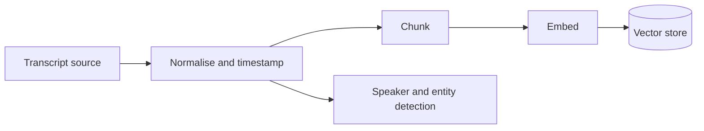

# podme: Architecture

## System overview

Three clients share one backend. The extension and the website are different views on the same transcripts.

## Ingestion

- **Transcript sources:** platform captions, HTML5 tracks, lecture-portal captions and captured captions.
- **Chunking** keeps timestamps, so every chunk maps back to a time range.
- **Entities.** Who is speaking is detected and cached per video.

## Retrieval and answers

1. A question is embedded and matched against the video's chunks in the vector store.
2. The model writes a summary from the retrieved chunks.
3. **Quote anchoring.** Each quote in the answer is matched back to the transcript and linked to the exact second it was spoken.

This is the step my thesis studies: whether the anchored quote actually supports the claim it is attached to, and whether several sources agree.

## Context and fact checks

- **Context** adds a short, checked background for a claim, with code checks on the output.
- **Fact check** uses the four-level cascade: professional fact-check databases, official data, trusted news sources, scored open-web search. Each level has a confidence ceiling, and every verdict lists its sources.
- A **whole-video scan** classifies claims, prioritises them and verifies the top ones.

## Quality

- A large set of offline tests covers each module.
- A frozen benchmark set measures the fact-check cascade after every change.
- A cheap smoke test runs at each backend start.

## Design decisions

- **One backend, many clients.** New clients such as a phone app reuse the same pipeline.
- **Timestamps everywhere.** Time ranges stay attached from ingestion to the final quote.
- **Verdicts carry sources.** No verdict is shown without the pages it rests on.
